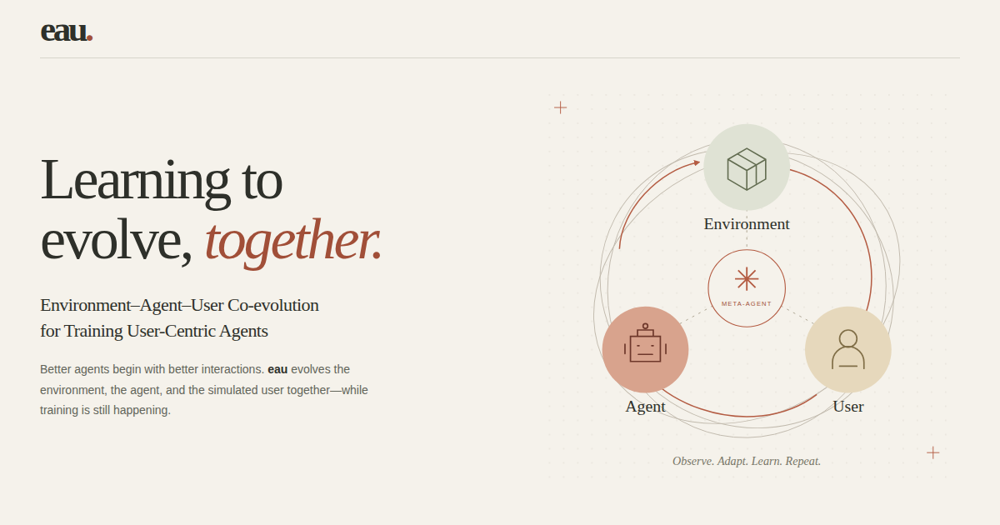

# EAU: Environment–Agent–User Co-evolution for Training User-Centric Agents

**项目主页：** [https://eau-meta-agent.github.io/](https://eau-meta-agent.github.io/)

**论文：** [arXiv:2610.16523](https://arxiv.org/abs/2610.16523)

EAU is a meta-agent framework for environment–agent–user co-evolution in multi-turn reinforcement learning. It adapts the simulated user, environment, reward design, and RL configuration as the agent learns. The paper evaluates EAU on UserGym, ColBench, and τ²-bench. The [project website](https://eau-meta-agent.github.io/) presents the method, related work, results, figures, and citation. This repository contains the project website; the training code is still under review.

独立的英文论文项目主页，内容来自本项目的 LaTeX source。采用奶油白、陶土色、鼠尾草绿和衬线排版，配有原创 SVG 共演化示意图、方法切换、双模型实验图表、论文原图和 BibTeX 复制。

纯 HTML / CSS / JavaScript，无构建步骤、无运行时依赖、无外部字体或 CDN。整个文件夹可单独上传 GitHub。



## 本地查看

直接打开 `index.html`，或在本文件夹运行：

```bash
python3 -m http.server 8000
```

访问 `http://localhost:8000`。

## GitHub Pages 部署

1. 将 **本文件夹内的全部文件** 上传到 GitHub 仓库根目录，包含 `.nojekyll` 和 `assets/`。
2. 在仓库 **Settings → Pages** 中选择 **Deploy from a branch**，选择对应分支和 **/ (root)**，保存。
3. 用户或组织主页仓库使用 `<username>.github.io` 命名，普通仓库则使用项目路径。页面采用相对路径，两种情况均可使用。

如果将本文件夹保留在其他仓库的子目录，GitHub Pages 的 branch 模式不能直接选择任意子目录。可以将内容复制到仓库根目录或 `docs/`，或自行配置 Actions 上传此文件夹。无需引入框架。

## 填写论文与代码链接

编辑 `site-config.js`：

```js
window.EAU_CONFIG = {
  paperUrl: 'assets/paper.pdf', // 也可以使用完整的论文链接
  codeUrl: 'https://github.com/your-org/eau',
};
```

放入正式论文后，所有论文下载入口自动切换为 “Read the paper”。代码链接为空时显示 “Code · forthcoming”。这些示例地址没有被设置为当前链接。

论文链接指向 arXiv:2610.16523，首屏和 Resources 区的 arXiv 按钮直接写在 `index.html` 中。

`og:url` 与 `og:image` 已使用正式地址 `https://eau-meta-agent.github.io/`。

## 文件

```text
project-page/
├── index.html             # 内容、作者、引用
├── styles.css             # 视觉与移动端适配
├── script.js              # 方法切换、实验图表、引用复制
├── site-config.js         # 正式论文与代码链接
├── .nojekyll              # 静态部署
├── assets/
│   ├── favicon.svg
│   ├── social-card.png    # 分享预览图
│   └── *.webp             # 由原论文 PDF 图转换
└── README.md
```

## 内容来源与核对

- 标题、作者、机构：`main.tex`。
- 方法与实验协议：`sections/method.tex`、`sections/experiment.tex`。
- UserGym / ColBench 原始分数：**`tables/usergym_results.tex`**。
- τ²-bench 原始分数：`tables/tau2bench_comparison.tex`。
- 图：`figs/eau_demo.pdf`、`figs/experience_analysis.pdf`、`figs/usergym_progression.pdf`，已转换为 WebP，点击可查看大图。
- 相对提升由表格原始数值计算。图表均从零开始，在切换模型时保持相同尺度。
- 引用使用 arXiv:2610.16523。代码因审核中，页面显示 “Code · coming soon (under review)”；公开后在 `site-config.js` 填入 `codeUrl`。

### 原稿中需要作者确认的差异

网页采用表格数据，未照搬不一致的正文数字：

| 项目 | 表格 / 计算值 | 正文中的值 |
| --- | --- | --- |
| Qwen3-4B UserGym average | 0.623 | 0.622 |
| Qwen2.5-7B UserGym average | 0.632 | 0.620 |
| Qwen2.5-7B overall relative gain | `(0.615 / 0.544 - 1) × 100 = 13.1%` | 14.7% |
| Qwen3-4B UserGym relative gain | `(0.623 / 0.559 - 1) × 100 = 11.4%` | 11.3% |

网页没有使用尚未填写的 Codex ablation 数值，也没有对未验证的外部模型版本做新增宣传。所有实验结果均指稿件中的模拟交互 benchmark 设置。

## 可用性

支持手机、平板和桌面；方法 tab 可使用方向键 / Home / End；图表提供可读表格；尊重 reduced-motion 偏好；剪贴板不可用时提供选中复制回退。所有资源随页面打包，可以离线打开。
