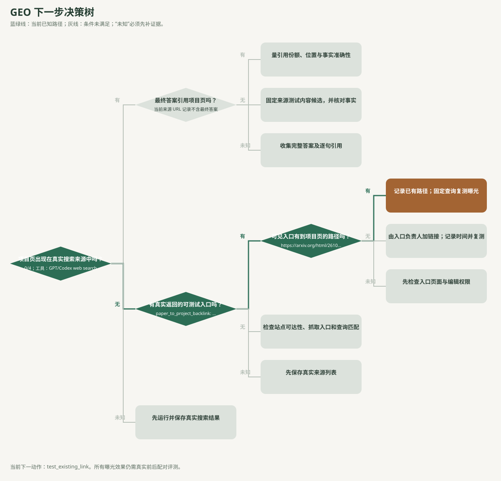

# EAU GEO 条件决策树



这才是用于**选择下一步动作**的树。菱形是判断条件，连线标“有 / 无 / 未知”，矩形是动作；绿色路径是当前证据走到的位置。机器可读版为 [decision-tree.json](decision-tree.json)。[证据层级图](figures/geo-exploration-overview.svg)和[历史过程图](figures/geo-optimization-process.svg)另有用途，不能替代条件决策。

当前路径由真实 GPT/Codex 工具来源 URL 得出：

```text
项目页出现在来源列表？          无（0/4）
  └─ 有真实返回的可测试入口？    有（EAU 论文页 4/4）
      └─ 可见入口有到项目页的路径？ 有（摘要页 → HTML 论文页 → 项目页）
          └─ 下一动作：固定查询，复测项目页曝光
```

已独立打开 [arXiv HTML 论文页](https://arxiv.org/html/2610.16523v1)上的项目链接并到达[EAU 项目页](https://eau-meta-agent.github.io/)；[摘要页](https://arxiv.org/abs/2610.16523)经 HTML 入口形成两跳路径。这里确认的是网页链接可达，**没有证据证明搜索 agent 会沿此路径，或项目页曝光会提升**。

| 条件转变 | 下一动作 | 不能提前声称的结果 |
| --- | --- | --- |
| 项目 URL 被真实返回 | 保存完整答案及逐句引用；再判断项目页是否被引用 | URL 出现不等于最终答案引用 |
| 项目 URL 未返回，且可见来源已有路径（当前） | 记录现有路径和页面版本；固定问题做真实复测 | 路径存在不等于搜索会跟随 |
| 项目 URL 未返回，可见来源确认无链接 | 由入口负责人添加链接，记录变更时间，再配对复测 | 修改完成不等于曝光提升 |
| 路径状态未知 | 核实页面；不改写为“无路径” | 不能把未知当作缺口 |
| 没有可见入口 | 检查项目页可达、抓取入口与查询匹配 | 图中可达性不是实际检索 |

无论走哪条修改分支，最终仍要用同平台、同查询的前后数据运行 `geo-compare`，查看覆盖率、全局增量和已观测平台退化。当前跨平台配对覆盖率为 0，所有提升结论保持未测。

重建：

```bash
python3 /path/to/autoresearch-wrapper/scripts/autoresearch_wrapper.py geo-decide \
  --repo . --config geo/config.json \
  --search-evidence geo/gpt-web-search-observations.json \
  --svg-out geo/figures/geo-decision-tree.svg > geo/decision-tree.json
```

路径状态通过 `geo/config.json` 中 `paper_to_project_backlink.link_state` 的 `present`、`absent` 或 `unknown` 填写，并用 `link_evidence_url` 指向独立核查的页面。`present` 在本例指摘要页经 HTML 论文页到项目页的可点击路径，**不表示摘要页本身有直链**。决策树随真实搜索证据和该状态重算。
