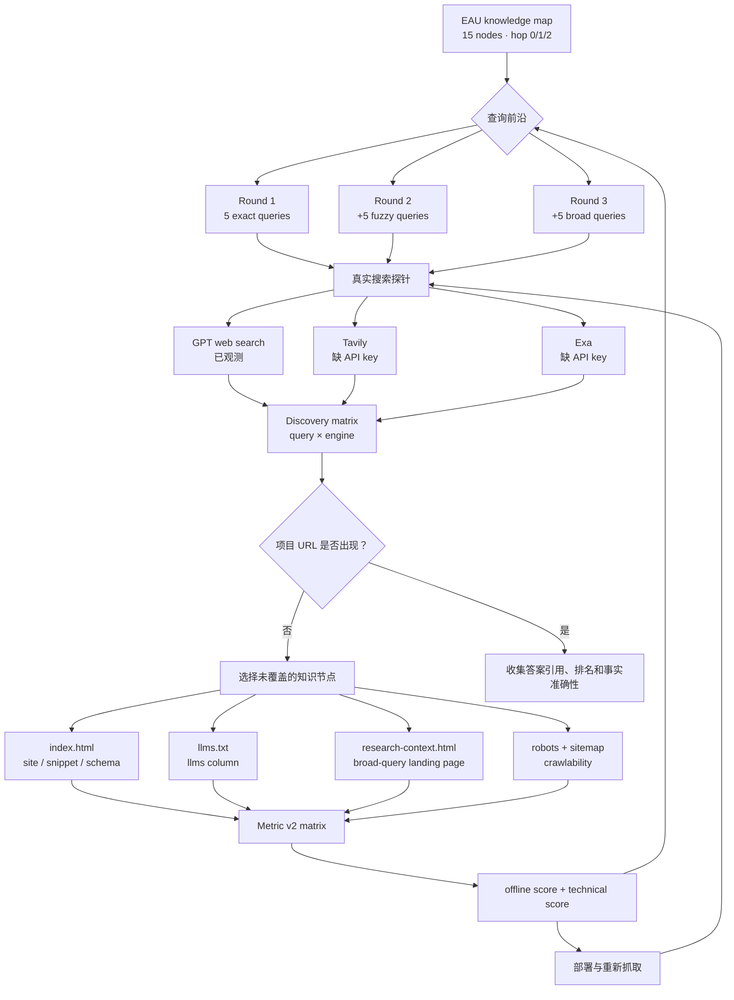

# EAU：GEO metric v2 三轮本地候选优化

本实验使用 `geo-fuzzy` 分支新增的知识图谱、搜索探针和评分矩阵。目标对象始终是 **EAU 项目域名** `eau-meta-agent.github.io`；论文被搜到与项目网页被搜到分别统计。

> 实验边界：三轮分数来自评分命令对三个本地候选页面快照的测量，不要求合并或部署。四个搜索入口只在新版本部署前测量过一次，属于线上基线；它们不是三轮候选修改后的搜索结果。因此，本报告证明页面可检索结构的离线指标提高，不证明真实搜索曝光已经提高。

## 新依赖树



机器可读树见 [dependency-tree.json](v2/dependency-tree.json)。节点之间的依赖是：页面内容决定 `site`，搜索摘要可见区域决定 `snippet`，JSON-LD 决定 `schema`，`llms.txt` 决定 `llms`，真实搜索记录决定 `search`。本地内容修改只有经过部署和搜索引擎重新抓取后，才可能改变 `search`。

## 三轮离线候选结果

| 本地快照 | 本轮用于诊断的查询集 | 本地 METRIC | matrix offline | technical | 本轮动作 |
| --- | --- | ---: | ---: | ---: | --- |
| 基线 | — | 68.63 | 53.83 | 90.83 | 建立 v2 map；修正非 Person 实体评分 |
| Candidate 1 | 5 个精确查询 | 84.80 | 74.67 | 100.00 | 新增 `llms.txt`；首屏明确 meta-agent 和 user-centric agents |
| Candidate 2 | 新增 5 个模糊查询 | 92.50 | 87.50 | 100.00 | 扩展 description、JSON-LD 和正文中的训练组件词 |
| Candidate 3 | 新增 5 个宽泛查询 | 93.00 | 88.33 | 100.00 | 新增 broad-query research context 页面并加入 sitemap |

逐查询结果见 [search-matrix.csv](v2/search-matrix.csv)，分数原始报告见 [baseline](v2/round-0-baseline.json)、[round 1](v2/round-1-exact.json)、[round 2](v2/round-2-fuzzy.json)和[round 3](v2/round-3-broad.json)。

## Round 3 最终评分矩阵

| signal | score | 含义 |
| --- | ---: | --- |
| `site` | 1.00 | 15 个知识节点均能在可见正文找到 |
| `snippet` | 0.73 | 关键词可在标题、description 或页面开头找到 |
| `schema` | 0.80 | 关键词进入 `ScholarlyArticle` JSON-LD |
| `llms` | 1.00 | 15 个节点均进入 `llms.txt` |
| `llm` | 空 | 当前没有配置独立 LLM endpoint |
| `search` | 0.29 | 对知识节点有关且已有真实观测的查询，按多引擎记录加权；各引擎完整覆盖率见下表 |
| `technical` | 1.00 | JSON-LD、metadata、robots、sitemap、llms.txt 均通过 |

最终 `METRIC=93.00`。`search` 不进入每轮优化的本地 METRIC；它作为部署外验证信号单独保存。本轮代码尚未部署，搜索引擎也尚未重新抓取，因此不能把现有引擎差异解释为这三轮修改造成的提升。

## 上线前搜索基线（仅测量一次）

下表的 15 条查询是在 Candidate 3 合并部署前执行的，用于记录后续复测的基线。精确、模糊、宽泛三组数字只是同一次基线测试的查询分组，不能与三个本地 Candidate 建立因果对应关系。

| 搜索入口 | 项目网页命中 | 精确 5 条 | 模糊 5 条 | 宽泛 5 条 | 说明 |
| --- | ---: | ---: | ---: | ---: | --- |
| GPT web search（当前会话） | 0/15 | 0/5 | 0/5 | 0/5 | 工具返回源中没有项目域名；论文/实体可出现 |
| Codex CLI `--search` | 4/15 | 4/5 | 0/5 | 0/5 | 精确词下项目页排名为 1、2、2、未命中、1 |
| Tavily Search API | 0/15 | 0/5 | 0/5 | 0/5 | `basic`，每条最多 10 个结果 |
| Exa Search API | 3/15 | 2/5 | 0/5 | 1/5 | `auto` + highlights，每条最多 10 个结果 |

统一的 `query × engine` 完整矩阵见 [discovery-all.md](v2/discovery-all.md)和[机器可读 JSON](v2/discovery-all.json)。所有入口均使用项目域名引用作为本表的命中条件；论文 URL 单独记录，不替代项目网页。

## 当前决策分支

```text
项目 URL 在 15 个真实查询中出现？  部分引擎出现
├─ Codex search                     4/15
├─ Exa search                       3/15
├─ GPT web search                   0/15
└─ Tavily search                    0/15
    └─ 模糊查询和宽泛查询稳定出现？ 否
    └─ 本地矩阵是否还有明显结构缺口？ 很少（93/100）
        └─ 下一动作：部署 → 等待重抓 → 用同一 15 查询复测
```

Tavily 与 Exa 使用运行时提供的密钥完成探测；密钥没有写入仓库或报告，临时密钥文件已在运行结束后删除。
