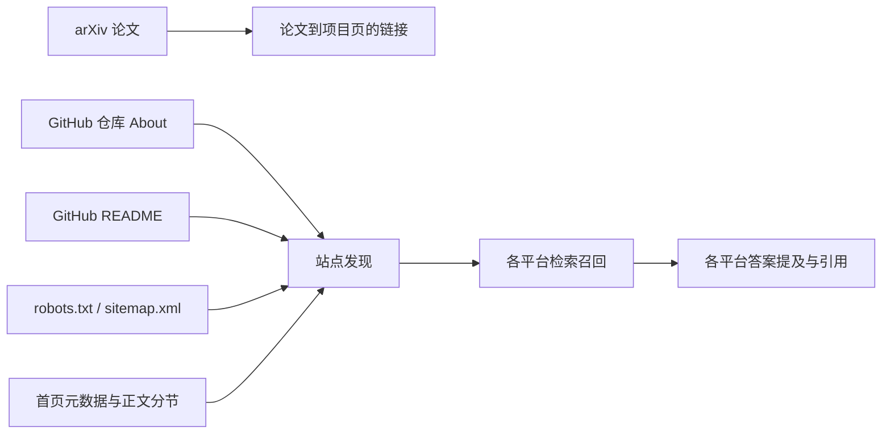

# EAU × Henry autoresearch-wrapper：依赖图、节点实验与全局评测

日期：2026-10-15。目标是提高 EAU **项目网页**在 agent 搜索中的自然发现和引用。论文 URL 与项目 URL 分开评估。本文使用 [HenryCai11/autoresearch-wrapper](https://github.com/HenryCai11/autoresearch-wrapper) 的 GEO 扩展；配置、操作清单、图和实验日志均在本目录。

**合并后更新（2026-10-16）：** EAU PR #6 已合并。即时 [Codex 网页搜索复测](evidence/codex-web-postmerge-20261016.md)在 Q1–Q4 显示项目 URL 0/4、arXiv URL 4/4，项目页曝光提升仍未证实。[交互式完整依赖图](figures/full-dependency-graph.html)显示全部 39 节点、47 条边；[查看说明](GRAPH_VIEWER.zh-CN.md)解释改动前后 JSON 的差异。此前的[简化图](figures/eau-dependency-graph-20261016.png)只显示关键路径。

**实验探索树（2026-10-16）：** [静态树状图](figures/geo-exploration-overview.svg)可直接查看节点和连线；[交互树](figures/geo-exploration-tree.html)可展开真实返回的来源 URL、查询、干预方案、依赖图节点和跨平台评测；[说明](EXPLORATION_TREE.zh-CN.md)区分已观测入口与未评测效果。它与完整依赖图用途不同。

**完整过程回放：** [过程图与逐步说明](OPTIMIZATION_PROCESS.zh-CN.md)展示历史 README 工作树实验、PR #6 合并、真实搜索复测，以及当前停在“论文入口路径已确认、跨平台效果未测”的位置。

**条件决策树：** [SVG](figures/geo-decision-tree.svg)按“项目页出现？→ 有可见入口？→ 链接状态？”给出有/无/未知分支，并高亮当前已有论文入口路径、应固定查询复测的分支；[说明](DECISION_TREE.zh-CN.md)保留判断依据与后续动作。

## 1. 依赖图：哪些节点可优化

`geo-graph` 对当前仓库建立了 **39 节点、47 条边**的基线图：[JSON](baseline-graph.json)。边表示信息流或可能的发现路径，**不是已证明的排名因果关系**。



| 节点组 | 已知状态与可操作处 | 本次判断 |
| --- | --- | --- |
| 首页 `title`、description、canonical、schema 和 6 个 `section` | 已有明确论文身份、相关工作、可抓取 HTML；可按分节增、改、移动、删除 | 暂无证据表明改写或重排会提升项目 URL 召回，暂不动 |
| `robots.txt`、`sitemap.xml` | 已存在，既有测试显示 HTTP 200 | 维持并监测 |
| GitHub README | 入口原先缺少项目首页链接和清晰研究摘要 | 在候选工作树中编辑 |
| GitHub About | 原 description/homepage 均为空 | 已用仓库 admin 权限填入项目描述与首页 URL；仓库外部状态变更，不计入本地分数增量 |
| arXiv → 项目页 | 论文能被搜索到；HTML 论文页已有可点击项目链接 | 摘要页经 HTML 页到项目页的路径已确认；搜索效果未测 |
| 各平台检索/答案 | 图中为 ChatGPT、豆包、DeepSeek、Claude、Grok 各建检索和答案节点 | 结果必须实测，图的可达性不能代替召回 |

已有 Codex web search 工具复测：Q1–Q4 两轮共 **项目网页 0/8，arXiv 论文 7/8**。这是 [既有测试方案](TEST_PLAN.zh-CN.md) 所载的工具结果，不等同 ChatGPT Search App，更不能推断其他平台。用户提供的一次豆包 Q1 最终答案没有提及 EAU，也没有项目 URL；缺少底层检索列表。

## 2. 操作节点：实际跑过的实验

本次将 Henry wrapper 原有的 `scan → configure → run → allocate → evaluate → record → finalize` 工作树循环用于 EAU。扩展后的扫描器能识别 README、HTML、CSS、SVG、robots 与 sitemap。`geo-apply` 对图节点提供 `replace_text`；HTML 分节提供 `edit`、`add_after`、`move_after`、`remove`，可先预览差异再写入候选工作树。本轮真正修改的是 README；分节操作有自动测试，但未在 EAU 上部署。

| 轮次 | 操作 | 本地 `geo_readiness` | 决策 |
| --- | --- | ---: | --- |
| seed | EAU 基线 `6fdd5e7` | 90/100 | 保留基线 |
| candidate-001 | [操作清单](operations/readme-backlink.json)：给 README 增加项目页、论文链接和英文摘要 | 100/100 | 保留，已合并到本 PR 分支 |
| candidate-002 | 在 001 之上再加中文摘要 | 100/100 | 分数持平，舍弃，减少维护负担 |

原始 [Henry run 日志](henry-run-results.tsv) 保留候选提交和 keep/discard 判定；[候选图](candidate-graph.json)与[基线图](baseline-graph.json)拓扑相同，只有 README 节点的内容指纹不同，见[差异清单](graph-diff.json)。10 个检查的 `geo_readiness` **只是本地可读性/入口代理指标**。它的 90→100 不表示搜索排名、曝光或引用提升，也不与历史 20 项网页评分混算。

复现实验的主要命令（在 EAU 仓库执行；`WRAPPER` 指向 Henry 扩展仓库脚本）：

```bash
python3 "$WRAPPER" geo-graph --repo . --config geo/config.json
python3 "$WRAPPER" geo-score --repo . --config geo/config.json
python3 "$WRAPPER" geo-apply --repo . --config geo/config.json --operations geo/operations/readme-backlink.json
python3 "$WRAPPER" geo-compare --config geo/config.json --observations geo/pending_agent_observations.csv --candidate readme-backlink
python3 "$WRAPPER" geo-prioritize --repo . --config geo/config.json --search-evidence geo/gpt-web-search-observations.json
python3 "$WRAPPER" geo-explore --repo . --config geo/config.json \
  --search-evidence geo/gpt-web-search-observations.json \
  --observations geo/pending_agent_observations.csv \
  --html-out geo/figures/geo-exploration-tree.html > geo/exploration-tree.json
```

具体 wrapper 命令、评分和 CSV 语义见其 `GEO.md`。操作需在 wrapper 分配的候选 Git worktree 中执行 `--apply`；此处列出的 `geo-apply` 不带该参数，只预览变更。

## 3. 当前优先级：只用本会话 GPT 网页搜索的真实返回

2026-10-16 再次对 Q1–Q4 各调用一次本会话网页搜索工具，原始响应分别保存为 [Q1](evidence/gpt-web-q1-20261016.txt)、[Q2](evidence/gpt-web-q2-20261016.txt)、[Q3](evidence/gpt-web-q3-20261016.txt)、[Q4](evidence/gpt-web-q4-20261016.txt)。[提取出的 URL](gpt-web-search-observations.json)显示：**项目域名 0/4、EAU arXiv 论文 4/4、EAU GitHub 仓库 0/4**。统计的是工具响应中显示的来源 URL，并无稳定的前十名次，也没有任何其他 App 的结果。

新版 [`geo-prioritize`](priorities.json)不再把图上“可达”的 11 个虚拟结果节点当作证据，也不使用手填的缺口标记和成本评分。它只数“某个入口 URL 出现在真实返回中，同时项目 URL 没出现”的查询次数。论文页对应 **4 个可测试入口机会**，因此排在下一次**固定查询复测现有路径**的首位；仓库、首页等来源在这四次返回中没有出现，无法凭本观测给它们排效果次序。所有改动的 `effect_status` 仍是 `unmeasured`。这个次序表示值得先测试哪里，**不是**论文链接会让项目页曝光提升 4 次。

复现：

```bash
python3 tools/build_gpt_web_evidence.py
python3 /path/to/autoresearch-wrapper/scripts/autoresearch_wrapper.py geo-prioritize \
  --repo . --config geo/config.json --search-evidence geo/gpt-web-search-observations.json
```

### 历史结构评分（已停用，不作为当前优先级）

[config.json](config.json) 对五个平台暂设各 0.2，对项目召回、项目引用、EAU 提及、论文召回和答案准确率分别设 0.30/0.35/0.15/0.10/0.10。这些是**公开、可改的决策权重**，不是平台流量或效果的测量。候选必须按同平台、同问题、同指标的前后数据配对；空白是未知，不能按 0 处理。`geo-compare` 会给全局增量的上下界；任一已观测平台跌幅超过 0.05 时也否决“已证实的全局收益”。

| 优先级 | 节点 | 基线结构优先分 | 状态 | 判断 |
| ---: | --- | ---: | --- | --- |
| 1 | README → 项目页 | 12 | 已生成候选、待上线及真实复测 | 成本低、外部入口明确；目前仅本地代理分数提升 |
| 2 | arXiv → 项目页 | 6 | HTML 论文页已有链接；搜索效果未测 | 论文 URL 已被工具检索，但不能据此推断搜索会沿链接发现项目页 |
| — | GitHub About | 0，已处理 | description/homepage 已写入 | 后续观测与 README 变化会混杂，需记录时间 |
| — | 首页身份、相关工作、抓取入口 | 0，当前无缺口 | 本轮维持 | 无需为了本地满分重复添加内容 |

历史结构优先分保存在 [legacy-structural-priorities.json](legacy-structural-priorities.json)，仅供解释原实验为什么先做 README；它把人工依赖路径当作“可达结果”，证据等级不足，已从当前排序移除。若将来观测到豆包改善、DeepSeek 变差，应另用真实的同平台前后结果计算全局增量和退化阈值；本轮只看 GPT 网页搜索结果。Henry 扩展的单元测试覆盖了平台冲突案例。

## 4. 前后结果与待填数据

| 环境 / 指标 | 历史前值 | 已上线旧页面的观测 | 本次 README 候选上线后 |
| --- | --- | --- | --- |
| Codex web search，项目页召回@10 | Q1 0/1 | Q1–Q4 两轮 0/8 | **未部署，空白** |
| Codex web search，arXiv 召回@10 | Q1 1/1 | Q1–Q4 两轮 7/8 | **未部署，空白** |
| 豆包 App，Q1 EAU 提及/项目引用 | 用户转贴答案 0/1、0/1；检索未知 | — | **空白** |
| ChatGPT Search / DeepSeek / Claude / Grok | — | — | **空白** |
| Henry 本地代理分数 | 90/100 | — | 候选 100/100，非曝光指标 |

[待填 40 行 CSV](pending_agent_observations.csv) 已预列 5 平台 × Q1–Q4 × 前/后阶段。请在真实产品的新会话中保留完整答案、来源列表、时间、模型、搜索模式和地区；只填写亲眼可判定的字段。历史前值如果无法补采，就保持空白，并把后续新基线与下一次改动配对。排名 `0` 仅表示已查看前十结果且未见目标 URL；空白表示无法判断。ChatGPT Search、豆包、DeepSeek、Claude、Grok 的 App 结果不可由 Codex web search 代替。

当前 [全局比较](global-comparison.json) 配对覆盖率为 **0**，增量界为 **[-1, 1]**；结论只能是证据不足。README 候选及 About 修改后的跨平台曝光提升**尚未证实**。合并部署后按 [测试方案](TEST_PLAN.zh-CN.md) 在上线、24 小时、72 小时、7 天采样；同一问题每平台至少 3 次独立新会话，再讨论方向性变化。

## 5. 可复核性与限制

- Henry 扩展测试：`python3 -m unittest -q`，75 项通过；涵盖图、分节移动/添加、README 编辑、缺失值和平台冲突。EAU 原有测试方案和两轮 Codex 检索证据也保留在 `geo/`。
- 图中外部入口属于假设链路。搜索系统索引、召回、摘要生成和最终引用有独立环节；任何一个本地检查通过都不保证曝光。
- 本次 README 改动尚在 PR；GitHub About 改动已直接生效，不能把之后的搜索变化单独归因于 README。
- 历史查询样本少，且两轮 Codex 检索发生在同一会话，不能当成独立八次实验。
