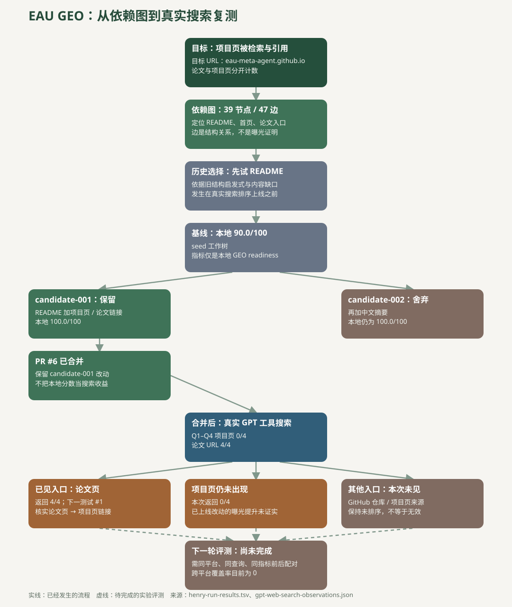

# EAU GEO：探索、修改、评测的完整过程

这张过程图由 [实验记录](henry-run-results.tsv) 和 [真实搜索返回 URL](gpt-web-search-observations.json)生成。可用 `python3 tools/build_geo_process.py` 重建。图中的实线表示已发生的工作；最后通向新评测的虚线表示待完成。

## 第一阶段：历史 README 实验

1. 在 EAU 仓库建成 [39 节点、47 边的依赖图](figures/full-dependency-graph.html)，识别仓库 README、项目页、论文和抓取入口。
2. 当时依照[旧结构启发式](legacy-structural-priorities.json)和 README 的内容缺口先选 README。**这一步发生在后来的真实搜索证据排序之前**，不能说是现在的 `geo-explore` 树自动选出来的。
3. Henry wrapper 分配 `seed`、`candidate-001`、`candidate-002` 三个独立工作树。`seed` 的本地 `geo_readiness` 是 90/100。
4. `candidate-001` 加入项目页、论文链接和英文摘要，得到 100/100，保留。`candidate-002` 在其基础上增加中文摘要，仍是 100/100，舍弃。[PR #6](https://github.com/eau-meta-agent/eau-meta-agent.github.io/pull/6) 合并了保留的改动。

这轮 90→100 只表示本地检查项改善，**没有衡量搜索曝光**。

## 第二阶段：合并后的真实搜索观测

在本会话的 GPT/Codex 网页搜索工具中，用 [Q1–Q4](gpt-web-search-observations.json) 查询：EAU 项目页 URL 0/4，EAU 论文 URL 4/4，EAU GitHub 仓库 URL 0/4。这里统计的是工具返回的来源 URL，不是 ChatGPT App 的结果，也不是稳定的前十排名。

于是新的 [交互探索树](figures/geo-exploration-tree.html)沿着真实可见的论文页分支，给“论文页 → 项目页链接”标记**下一测试 #1**。它表示值得先核实与测试的入口，不表示该链接已存在或能提高召回。项目页和仓库入口在这四次返回中未出现；其他干预保持未排序。

## 第三阶段：尚未完成的闭环

论文页链接状态需要核实；若由论文作者修改，还需记录变更时间和页面版本。之后按 [测试方案](TEST_PLAN.zh-CN.md)在同平台、同查询、同指标下收集独立的前后搜索和答案。只有配对数据齐备时，`geo-compare` 才能计算跨平台增量、缺失数据上下界和退化阈值。目前 [全局比较](global-comparison.json)覆盖率为 0；没有证据证明 EAU 项目页曝光已经提升。

下一轮的内容候选和答案级质量评测参考了 [GEO-Bench 与 AutoGEO 的适配方案](BENCHMARK_ADAPTATION.zh-CN.md)。两篇论文的生成阶段实验不直接解决当前项目页 0/4 的检索缺口，因此真实入口复测仍在前面。
